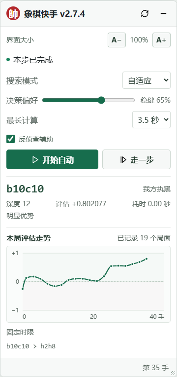
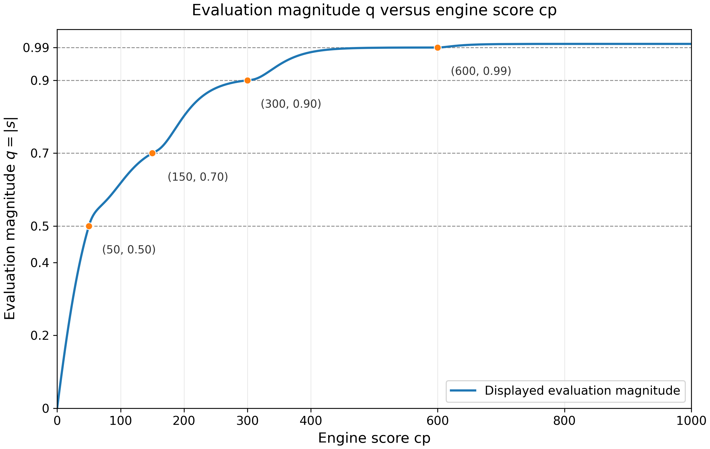

# 象棋快手 v2.7.4

[下载发行版](https://github.com/zhaopengbo-0702/xiangqi-quick-hands/releases/latest) · [逐版更新记录](CHANGELOG.md) · [评估公式](docs/evaluation-mapping.md) · [问题反馈](https://github.com/zhaopengbo-0702/xiangqi-quick-hands/issues) · [自动检查](https://github.com/zhaopengbo-0702/xiangqi-quick-hands/actions)

Chrome / Edge 浏览器扩展，内置 Pikafish WASM 与 NNUE，支持 Xiangqi.com 对局、题库和棋盘分析。面板支持拖动、整体缩放、后台运行，以及运行中调整搜索参数。

**2.7.4** 移除图下常驻评分与默认提示，鼠标悬停、手指触摸记录点或键盘聚焦时，在图内浮层显示手数和评估值，离开后隐藏。曲线继续按自己控制的棋子计算，并保留第 0 手真实开局采集。评分公式见 [评估转换与插值函数](docs/evaluation-mapping.md)。

## 安装与更新

使用 Chrome / Edge 116 或更新版本，下载 [xiangqi-quick-hands-v2.7.4.zip](https://github.com/zhaopengbo-0702/xiangqi-quick-hands/releases/download/v2.7.4/xiangqi-quick-hands-v2.7.4.zip)。安装包内含扩展、引擎、网络、对应源码和许可证。

1. 解压安装包，保留整个目录。
2. Edge 打开 `edge://extensions`；Chrome 打开 `chrome://extensions`。
3. 开启“开发人员模式”，点击“加载解压缩的扩展”，选择直接包含 `manifest.json` 的目录。
4. 更新旧版时，用新版文件替换原目录，再点击扩展的“重新加载”。
5. 刷新棋盘，确认面板标题为 **象棋快手 v2.7.4**。等待“引擎就绪”，点击“开始自动”或“走一步”。首次预热需要数秒。

源码安装时选择仓库中的 `extension` 文件夹。浏览器工具栏的扩展按钮可以展开或收起面板，安装目录用于浏览器持续加载扩展。安装包使用带版本号的文件名，校验值见同版 `SHA256SUMS.txt`。

## 页面支持

| 页面 | 操作 |
| --- | --- |
| 人机 `/computer-play` | 自动行棋、走一步 |
| 自己的在线棋局 `/game/:id` | 根据行棋方和剩余时间自动行棋 |
| 题库 `/puzzle/:id`、练习 `/P`、挑战 `/C` | 引擎解题；完成、判错或切题后暂停 |
| 题库竞速 `/puzzle/race/:id` | 按倒计时和剩余生命运行 |
| 分析、复盘、棋谱、课程、数据库和观战棋盘 | 点击“分析局面”查看建议 |
| 编辑器 `/editor/*` | 分析完整有效局面 |
| 大厅、题库列表、筛选、记录与统计 | 等待进入棋盘 |

每日残局进入题库页面时使用同一适配。题库从当前局面调用引擎计算，网站按题目规则判定；每道新题点击一次“开始自动”。竞速结束、生命耗尽或题目完成后，面板显示相应状态。

## 面板操作

拖动标题栏移动面板，双击恢复默认位置和 100% 大小。拖动边缘或四角整体缩放，文字、按钮和图标同步变化；A− / A+ 每次调整 10%。常规缩放范围为 80% 至 250%，小屏幕自动适应宽度，超高内容可滚动。位置和比例自动保存。

“搜索模式”“最长计算”和自适应模式下的“决策偏好”均可在运行中调整，新选择从下一步生效。偏好滑条的百分比实时更新，松开后保存，刷新后恢复。

“反侦查辅助”开关位于参数区，控制选子前后的随机短暂停顿和点击位置变化，设置会保存，运行中切换从下一步生效。

## 本局评估走势



界面示例，使用模拟评估数据。

主面板中的平滑走势曲线随每次成功计算更新，横轴为评估所在局面的手数，每一手表示一个单方步；纵轴固定为 −1 至 +1。参与对局时，曲线自动按自己控制的棋子计算，正值自己有利、负值对方有利，零线表示均势，双方轮流行棋时保持同一比较方向。图下没有常驻评估详情或默认提示；鼠标悬停、手指触摸记录点或键盘聚焦时，图内浮层显示对应手数和评估值，移开、松开或失去焦点后隐藏。

连线采用保形分段三次 Hermite 插值（PCHIP），相邻段的一阶导数连续，段内保持在相邻两个评估点的数值范围内。曲线平滑仅影响连线，实际评估点不变。这一步用于连接对局中的记录点，与下节将原始评分转换为面板分数的 PCHIP 用途不同。全部节点斜率、Hermite 函数和 SVG 控制点公式见 [走势记录与平滑公式](docs/evaluation-history.md)。

普通评分使用下节的六位局势指数；计算局面的行棋方与图表视角方相同时按原分数绘制，不同时取相反数。非零杀棋在图上标记于 +1 或 −1，参与对局时标注“我方杀棋”或“对方杀棋”；数字评估仍显示“杀棋 N”。引擎报告“杀棋 0”时跳过图表记录。

开启“开始自动”或“走一步”后，系统会真实计算本局初始局面，记录第 0 手评估；这次开局采集只做分析，不落子。开局点来自引擎评分，不预设为零。执黑时也会先补齐开局点，再记录正常行棋时的评估点。

同一手再次计算会更新对应点。暂停、收起面板或重新连接引擎后继续保留本局记录；切换对局、题目或识别人机重新开局时自动清零。中途进入时，也可根据网站提供的本局初始局面补采第 0 手；其他未计算过的历史手数不补造。开局采集失败时保留空缺并稍后重试，自动行棋继续运行。刷新页面后重新开始记录。

## 评估显示

面板显示六位局势指数：正值有利，负值不利，零附近为均势。视角采用本次计算开始时的行棋方。引擎给出强制杀棋时，面板显示“杀棋 N”。

普通评分的计算链为：

```math
\begin{aligned}
x &= \frac{\mathrm{cp}}{100},\\
u &= \tanh(1.5x)=\tanh(0.015\,\mathrm{cp}),\\
y &= \mathrm{sgn}(u)\,P\!\left(\lvert u\rvert\right),\\
s &= \mathrm{round}_{6}\!\left(\mathrm{clip}(y,-0.999999,0.999999)\right).
\end{aligned}
```
其中 $`\mathrm{cp}`$ 是引擎的局势评分单位，$`100\,\mathrm{cp}`$ 对应旧面板的 $`1.00`$；$`P`$ 是保单调 PCHIP 分段三次 Hermite 插值。插值使用完整精度的 $`u`$，六个节点如下：

| 输入 $`\lvert u\rvert`$ | 输出 $`P(\lvert u\rvert)`$ |
| --- | --- |
| $`0`$ | $`0`$ |
| $`0.635148952387`$ | $`0.5`$ |
| $`0.978026114739`$ | $`0.7`$ |
| $`0.999753210848`$ | $`0.9`$ |
| $`0.999999969540`$ | $`0.99`$ |
| $`1`$ | $`1`$ |

负分对称处理。完整的引擎评分来源、节点斜率、五段插值函数与系数见 [数学说明](docs/evaluation-mapping.md)。例如：

```math
\begin{aligned}
\mathrm{cp}&=22,\qquad x=0.22,\\
u&=\tanh(0.33),\\
y&\approx0.271333693,\\
s&=+0.271334.
\end{aligned}
```
令 $`q=\lvert s\rvert`$，按面板显示值分档：



上图由 Python / Matplotlib 绘制，展示 $`\mathrm{cp}\ge0`$ 时 $`q`$ 与原始评分的关系，标出四个分界点。完整的 $`q(\mathrm{cp})`$ 分段解析式及每段系数见 [函数曲线与直接解析式](docs/evaluation-curve.md)。[PNG](docs/assets/evaluation-q-vs-cp.png) · [SVG](docs/assets/evaluation-q-vs-cp.svg) · [PDF](docs/assets/evaluation-q-vs-cp.pdf) · [数据 CSV](docs/assets/evaluation-q-vs-cp.csv) · [绘图脚本](scripts/plot_evaluation_curve.py)

| 显示绝对值 $`q`$ | 正分 / 负分分档 |
| --- | --- |
| $`q<0.5`$ | 均势 |
| $`0.5\le q<0.7`$ | 稍优 / 稍劣 |
| $`0.7\le q<0.9`$ | 明显优势 / 明显劣势 |
| $`0.9\le q<0.99`$ | 大幅优势 / 大幅劣势 |
| $`q\ge0.99`$ | 接近胜势 / 接近败势 |

## 搜索参数与时间分配

默认采用自适应模式，决策偏好 65%，最长计算 3.5 秒。固定时限模式按所选时限计算；自适应模式根据候选接近程度、最佳着法变化、评分波动、重要吃子和应将状态分配时间。

普通局面至少完成 6 层搜索。每层表示一个单方步，深度来自引擎的选择性搜索。面板还显示实际耗时、重要性、搜索预算和最多 8 个单方步的预测线路。

引擎先搜索约 450 ms，比较两条候选线路，再更新重要性 $`I`$：

```math
\begin{aligned}
U &= e^{-\Delta/120},\\
C &= \frac{\text{最近迭代中最佳着法变化次数}}{\text{相邻迭代次数}},\\
V &= \min\!\left(1,\frac{\text{最近相邻评分最大变化}}{120}\right),\\
I &= \mathrm{clip}(0.05+0.45U+0.20C+0.20V+0.20T,0,1),\\
B &= \min\!\left(L,650+2850I^{1.4-0.8\beta}\right)\ \mathrm{ms}.
\end{aligned}
```
$`\Delta`$ 是同一完成深度下两条候选的评分差；$`C`$ 和 $`V`$ 使用最近 6 次迭代；$`T`$ 是预测线路前 4 步的重要吃子权重，车为 $`1`$、炮为 $`0.8`$、马为 $`0.7`$。$`L`$ 是用户选择的最长计算时间，$`\beta`$ 是决策偏好，默认 $`0.65`$。候选比较尚未完成时，$`U=0.85`$。

正在应将时，$`I\ge0.85`$；只有一个合法着法时，$`I=0`$，预算为 650 ms。确定正向杀棋时可以提前结束。重要性用于时间分配，鼠标悬停可查看本步原因。

## 暂停、确认与后台运行

开启后在同一局持续运行。点击“暂停自动”或右上角暂停图标，再点击独立的“确认暂停”才会暂停。“继续运行”、Esc 或 8 秒未确认会收起确认条。

落点发送前的动作预算最多 5 秒。发送后显示“等待网站确认落子”，确认到预计局面或近期棋谱中的对应记录后继续。读取超时、短暂同步或加载进入等待；换局、回放、身份变化、判错和终局会显示具体状态。确认等待中也可按两步操作暂停。

自动行棋支持切换标签页、其他窗口覆盖和最小化。运行期间保持浏览器、棋局页面和网络连接。页面冻结、电脑休眠或浏览器关闭会中断处理；恢复后读取最新局面，核对当前动作状态。

多个棋局共用一个引擎，同一时间计算一局。更新扩展、刷新或开始新局后，点击“开始自动”继续。在线对局的计算预算随剩余时间收紧，例如剩余 1.8 秒时最多计算约 0.9 秒。

## 引擎与开发

浏览器引擎来自 `brianhliou/pikafish-wasm v0.1.0`，固定上游为官方 Pikafish 提交 `6a59ee2f`，使用 Negamax / Alpha-Beta 搜索与 NNUE 网络。浏览器模式最多 4 线程、64 MiB 置换表，启动时校验网络文件并预热。完整棋谱交给引擎重建和核对。

源码中的原生通信兼容性、开发服务和构建方式见 [CONTRIBUTING.md](CONTRIBUTING.md)。测试推荐 Node.js 22、Python 3.9 或更新版本：

```powershell
npm.cmd test
npm.cmd run check
npm.cmd run package
```

回归覆盖搜索、预算、超时、暂停、棋盘桥接和原生通信。`scripts/panel-smoke.cjs` 检查面板交互和缩放；`scripts/puzzle-smoke.cjs` 检查题库、分析、参数修改及迟确认；`scripts/browser-smoke.cjs` 检查后台和最小化运行。浏览器检查使用本地棋盘夹具，需要 Playwright 与 Chromium，可用 `PLAYWRIGHT_CHROMIUM_EXECUTABLE_PATH` 指定浏览器。各版执行结果见 [CHANGELOG.md](CHANGELOG.md)。

## 文件与授权

`extension` 是可加载扩展，`tests` 是回归测试，`scripts` 是开发和打包工具，`native-host` 保留原生通信兼容性。

项目源码采用 **GPL-3.0-or-later**。Pikafish、NNUE 权重、Fairy-Stockfish 和图标分别附有对应许可证与来源。NNUE 权重的独立许可见 `extension/engine/pikafish/NNUE-License.md`；完整材料见 [第三方授权与来源](THIRD_PARTY_NOTICES.md)。
