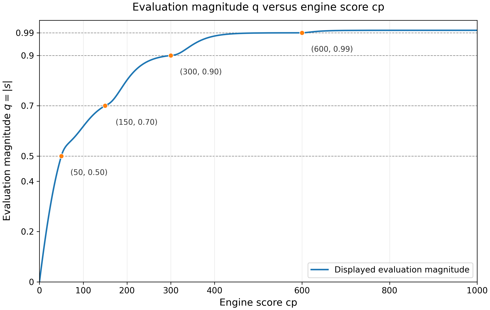

# 最终面板绝对值 q 与引擎百分兵分的曲线及解析式

本页将当前评分转换写成直接以 $`\mathrm{cp}`$ 为输入的完整分段解析式，并给出 Python 绘图入口。算法沿用自 v2.6.1 起的评分映射。

## 曲线与复现入口



曲线使用标准 Matplotlib 默认样式，只有一个坐标轴，展示正半轴 $`\mathrm{cp}\in[0,1000]`$，图内采用英文标注，并标出 $`q=0.5,0.7,0.9,0.99`$ 四个分界。可下载 [PNG 图片](assets/evaluation-q-vs-cp.png) 或 [SVG 矢量图](assets/evaluation-q-vs-cp.svg)，绘图代码见 [`scripts/plot_evaluation_curve.py`](../scripts/plot_evaluation_curve.py)。

面板有符号分数记为 $`s`$，图中纵轴为其绝对值 $`q=|s|`$。因此 $`q`$ 是偶函数，反映局势偏离均衡的程度；$`s`$ 的正负分别表达本次搜索行棋方视角下的有利与不利。完整评分来源、节点斜率与 Hermite 构造见 [评估的各次转换与插值函数](evaluation-mapping.md)。

## 变量与六个节点

令 $`r=|\mathrm{cp}|`$。变换的正半轴输入为：

```math
b(r)=\tanh(0.015r).
```

六个节点采用以下精确十进制字面值。$`X_i`$ 是上一版未舍入 tanh 评分的绝对值，$`Y_i`$ 是当前插值目标：

| $`i`$ | $`X_i`$ | $`Y_i`$ |
| --- | --- | --- |
| $`0`$ | $`0`$ | $`0`$ |
| $`1`$ | $`0.635148952387`$ | $`0.5`$ |
| $`2`$ | $`0.978026114739`$ | $`0.7`$ |
| $`3`$ | $`0.999753210848`$ | $`0.9`$ |
| $`4`$ | $`0.999999969540`$ | $`0.99`$ |
| $`5`$ | $`1`$ | $`1`$ |

插值完成后才进行钳制和六位显示。以下先写出连续部分 $`g(r)`$，最后单独定义面板绝对值 $`q(\mathrm{cp})`$。

## 将区间边界直接换算为百分兵分

对 $`i=1,2,3,4`$，解方程 $`\tanh(0.015c_i)=X_i`$：

```math
c_i=\frac{\mathrm{atanh}(X_i)}{0.015}
=\frac{100}{3}\ln\!\left(\frac{1+X_i}{1-X_i}\right).
```

补充端点 $`c_0=0`$、$`c_5=+\infty`$。用高精度十进制计算节点字面值，可得：

| $`i`$ | $`c_i`$ 的高精度近似值 |
| --- | --- |
| $`0`$ | $`0`$ |
| $`1`$ | $`49.999999999967892943429547292230`$ |
| $`2`$ | $`150.000000000285839832882063711903`$ |
| $`3`$ | $`299.999999996280233745609218897246`$ |
| $`4`$ | $`599.999955160311353248317562343146`$ |
| $`5`$ | $`+\infty`$ |

这些边界由既定 $`X_i`$ 反解；它们分别接近 $`50,150,300,600`$，数学定义保留上表字面节点产生的精确边界。常规双精度存储与计算会使边界末位略有变化，特别是接近 $`1`$ 的 $`X_4`$；例如将二进制浮点值直接代入反双曲正切，可得到约 $`599.9999551966883`$。原始引擎通常报告整数 $`\mathrm{cp}`$，按最终六位值分档也沿用面板显示规则。

## 五个区间的直接解析式

定义区间宽度和局部变量：

```math
h_i=X_{i+1}-X_i,\qquad
T_i(r)=\frac{\tanh(0.015r)-X_i}{h_i},\qquad i=0,\ldots,4.
```

每段已经展开成三次多项式：

```math
G_i(r)=A_iT_i(r)^3+B_iT_i(r)^2+C_iT_i(r)+D_i.
```

完整系数如下；$`h_i`$ 列按精确十进制节点相减，$`A_i,B_i,C_i,D_i`$ 保留当前双精度算法的参考值。

| $`i`$ | $`h_i`$ | $`A_i`$ | $`B_i`$ | $`C_i`$ | $`D_i`$ |
| --- | --- | --- | --- | --- | --- |
| $`0`$ | $`0.635148952387`$ | $`0.003501168314592769`$ | $`-0.08761269627027911`$ | $`0.5841115279556863`$ | $`0`$ |
| $`1`$ | $`0.342877162352`$ | $`0.3337808544377575`$ | $`-0.36018306964360114`$ | $`0.22640221520584358`$ | $`0.5`$ |
| $`2`$ | $`0.021727096109`$ | $`0.19743013869620432`$ | $`-0.029581199392770027`$ | $`0.03215106069656577`$ | $`0.7`$ |
| $`3`$ | $`0.000246758692`$ | $`0.09578825340447801`$ | $`-0.012208233562085181`$ | $`0.006419980157607156`$ | $`0.9`$ |
| $`4`$ | $`0.000000030460`$ | $`-0.009965516182746442`$ | $`0.01993226524626417`$ | $`0.00003325093648228132`$ | $`0.99`$ |

逐段写出：

```math
\begin{aligned}
G_0(r)={}&0.003501168314592769T_0^3
-0.08761269627027911T_0^2\\
&+0.5841115279556863T_0,\\
G_1(r)={}&0.3337808544377575T_1^3
-0.36018306964360114T_1^2\\
&+0.22640221520584358T_1+0.5,\\
G_2(r)={}&0.19743013869620432T_2^3
-0.029581199392770027T_2^2\\
&+0.03215106069656577T_2+0.7,\\
G_3(r)={}&0.09578825340447801T_3^3
-0.012208233562085181T_3^2\\
&+0.006419980157607156T_3+0.9,\\
G_4(r)={}&-0.009965516182746442T_4^3
+0.01993226524626417T_4^2\\
&+0.00003325093648228132T_4+0.99.
\end{aligned}
```

其中每一个 $`T_i`$ 都取上文明确给出的 $`T_i(r)`$。连续部分的分段函数是：

```math
g(r)=
\begin{cases}
G_0(r),&0\le r\lt c_1,\\
G_1(r),&c_1\le r\lt c_2,\\
G_2(r),&c_2\le r\lt c_3,\\
G_3(r),&c_3\le r\lt c_4,\\
G_4(r),&c_4\le r\lt +\infty.
\end{cases}
```

每段均由已列出的常数和初等函数直接计算。节点满足 $`g(c_i)=Y_i`$，且相邻段的一阶导数连续。$`g(0)=0`$，当 $`r\to+\infty`$ 时有 $`g(r)\to1`$。

## 等价的有理指数表达式

还可以将每段写成仅含指数和四则运算的函数。令：

```math
z(r)=e^{-0.03r},\qquad
N_i(r)=(1-X_i)-(1+X_i)z(r).
```

由于：

```math
\tanh(0.015r)=\frac{1-z(r)}{1+z(r)},\qquad
T_i(r)=\frac{N_i(r)}{h_i(1+z(r))},
```

将 $`T_i(r)`$ 逐项代入三次多项式，得到：

```math
\begin{aligned}
G_i(r)={}&\frac{A_iN_i(r)^3}{h_i^3(1+z(r))^3}\\
&+\frac{B_iN_i(r)^2}{h_i^2(1+z(r))^2}\\
&+\frac{C_iN_i(r)}{h_i(1+z(r))}\\
&+D_i.
\end{aligned}
```

四行依次对应 $`A_iT_i^3`$、$`B_iT_i^2`$、$`C_iT_i`$ 和 $`D_i`$；各项分母的幂次分别为 $`3`$、$`2`$、$`1`$ 和 $`0`$。与前述五段区间及常数表组合后，即可直接输入 $`r=|\mathrm{cp}|`$ 计算。实际实现采用局部多项式的 Horner 求值形式：

```math
G_i(r)=\bigl((A_iT_i(r)+B_i)T_i(r)+C_i\bigr)T_i(r)+D_i.
```

## 最终面板绝对值 q

连续映射完成后执行六位显示规则。令 $`R_6`$ 与面板 `toFixed(6)` 使用相同舍入规则，最终函数为：

```math
q(\mathrm{cp})=
R_6\!\left(
\min\!\left(0.999999,\max\!\left(0,g(|\mathrm{cp}|)\right)\right)
\right).
```

相应有符号面板分数为：

```math
s(\mathrm{cp})=\mathrm{sgn}(\mathrm{cp})q(\mathrm{cp}),\qquad
\mathrm{sgn}(0)=0.
```

$`q`$ 满足 $`q(-\mathrm{cp})=q(\mathrm{cp})`$。正负输入使用同一个偏离均衡程度，优势或劣势方向由 $`s`$ 的符号保留。

上述 $`g`$ 是连续、分段解析的函数，$`q`$ 是最后经过六位舍入的离散显示结果。分档按显示绝对值 $`q`$ 判断：

| 显示绝对值 $`q`$ | 正分 / 负分分档 |
| --- | --- |
| $`q<0.5`$ | 均势 |
| $`0.5\le q<0.7`$ | 稍优 / 稍劣 |
| $`0.7\le q<0.9`$ | 明显优势 / 明显劣势 |
| $`0.9\le q<0.99`$ | 大幅优势 / 大幅劣势 |
| $`q\ge0.99`$ | 接近胜势 / 接近败势 |

## 复算示例

以 $`\mathrm{cp}=22`$ 为例：

```math
\begin{aligned}
r&=22,\\
b(r)&=\tanh(0.33)\approx0.31852077690277081,\\
T_0(r)&=\frac{0.31852077690277081}{0.635148952387}
\approx0.50148988785341531,\\
g(r)&=G_0(r)\approx0.27133369297884041,\\
q(22)&=0.271334,\qquad s(22)=+0.271334.
\end{aligned}
```

同理 $`q(-22)=0.271334`$，$`s(-22)=-0.271334`$。插值和有理指数表达在相同区间内给出一致结果，最后统一应用六位显示规则。
